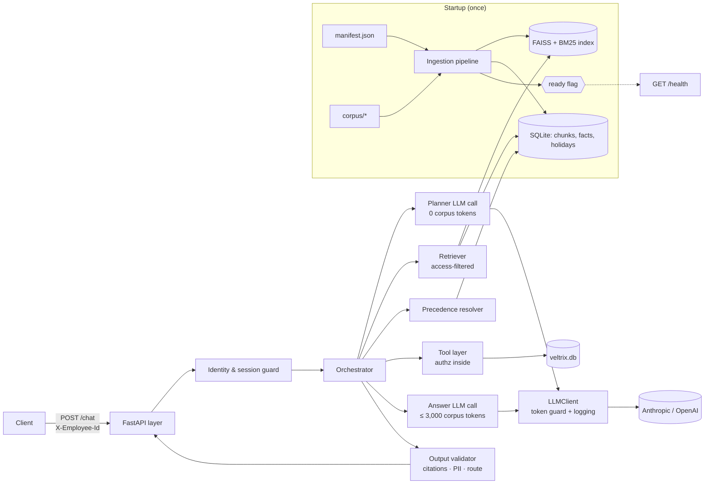
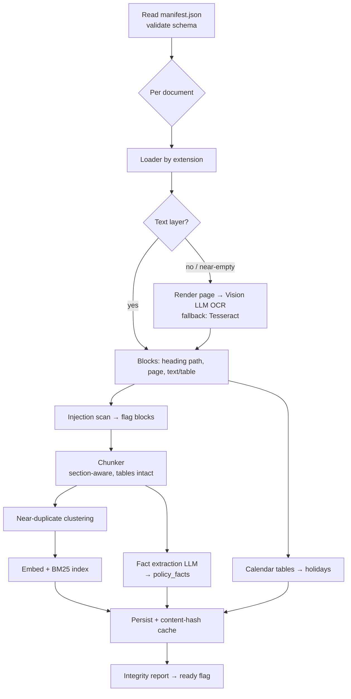
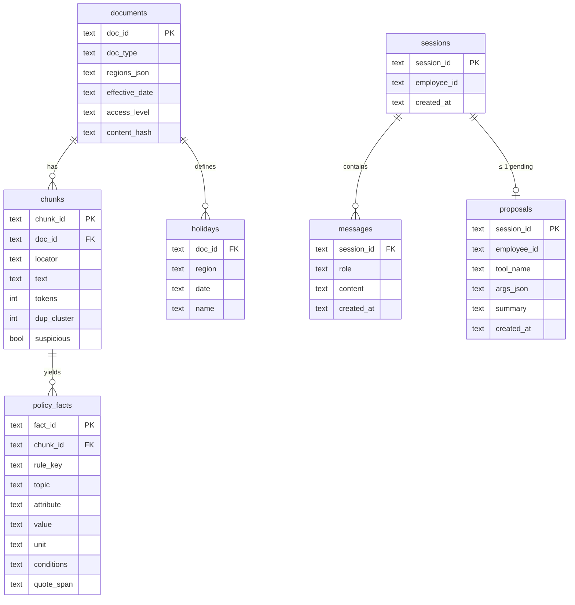
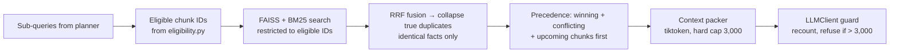
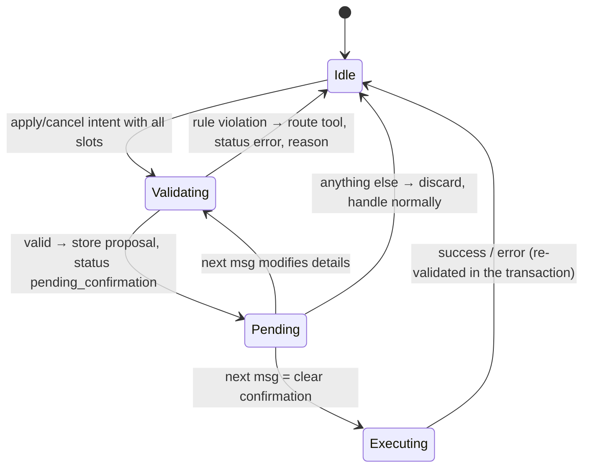

# Veltrix PeopleOps Assistant — Architecture

> Senior AI Engineer assessment. This document is the build blueprint: components, data flow, key design decisions and trade-offs.
> Status: **draft v1**, written before inspecting the corpus. Sections marked ⚠ must be validated once `corpus/`, `manifest.json` and `veltrix.db` are available.

---

## 1. Design principles

| # | Principle | Why it matters here |
|---|---|---|
| P1 | **Deterministic logic in code, language in the LLM** | Precedence, eligibility, working days, permissions and leave rules are testable functions. The LLM interprets the user and writes the answer; it never decides *who may see what*. |
| P2 | **Security by construction, not by prompt** | Restricted docs are excluded *at the index query*; permissions run *inside tools* from the header identity. The prompt is never a security boundary. |
| P3 | **Structure extracted once, at ingestion** | Holidays, accrual tables and policy "rules" become typed rows. Answers and conflict detection then work on data, not on re-reading prose. |
| P4 | **Budget enforced at the boundary** | One chokepoint (`LLMClient`) counts corpus tokens and refuses any call above 3,000 — no code path can bypass it. |
| P5 | **Nothing from the corpus in code** | No hardcoded values, file names, headings or table layouts → survives the modified corpus. |
| P6 | **Bounded, predictable latency** | Fixed pipeline of ≤ 2 LLM calls per message (≤ 3 in rare retries) to stay well under 30 s and keep outputs reproducible. |

---

## 2. System overview



---

## 3. Technology choices

| Concern | Choice | Reason / trade-off |
|---|---|---|
| API | **FastAPI + Uvicorn**, Pydantic v2 models | Strict request/response schemas → exact contract, free 400 handling. |
| LLM | **Anthropic (default)** behind `LLMProvider` interface; OpenAI adapter | Reviewers use their own key; native tool/JSON output; temperature 0. |
| Embeddings | **fastembed `BAAI/bge-small-en-v1.5`** (ONNX, CPU) | No torch → small image, fast startup, no external dependency at query time. |
| Vector store | **FAISS `IndexFlatIP`** + `IDSelectorBatch` pre-filter | Corpus is tiny; exact search; pre-filter guarantees restricted chunks are never candidates. |
| Lexical | **rank_bm25** | Policy questions are keyword-heavy ("sick leave", "carry forward"); hybrid beats dense alone. |
| Fusion | **Reciprocal Rank Fusion** | Parameter-light, stable, deterministic. |
| Parsing | `pypdf`/`pdfplumber` (PDF + tables), `python-docx`, `markdown-it`, `BeautifulSoup` | Each preserves headings and tables in a common block model. |
| OCR | **Vision LLM** primary, **Tesseract** fallback | Vision handles tables in scans well; Tesseract keeps ingestion alive if the LLM is unavailable. |
| Tokens | `tiktoken` `cl100k_base` | Required by spec. |
| Storage | **SQLite** (`veltrix.db`, new tables only) | One file, transactional, no extra service. |

---

## 4. Repository layout

```
veltrix-assistant/
├── app/
│   ├── main.py                 # FastAPI app, /chat, /health, error mapping
│   ├── config.py               # env vars, APP_TODAY resolution
│   ├── api/schemas.py          # ChatRequest, ChatResponse, Citation, ToolCall
│   ├── ingestion/
│   │   ├── pipeline.py         # orchestrates ingestion, sets ready flag
│   │   ├── loaders/            # pdf.py, docx.py, markdown.py, html.py, ocr.py
│   │   ├── blocks.py           # normalized Block/Section model
│   │   ├── chunker.py          # structure-aware chunking
│   │   ├── dedup.py            # near-duplicate clustering
│   │   ├── extract_facts.py    # LLM → typed policy facts
│   │   ├── extract_holidays.py # calendar tables → holidays rows
│   │   └── injection_scan.py   # flags instruction-like text
│   ├── retrieval/
│   │   ├── eligibility.py      # access/region/date rules (pure functions)
│   │   ├── index.py            # FAISS + BM25, filtered search
│   │   ├── precedence.py       # authority → scope → recency resolver
│   │   └── context_packer.py   # token-budgeted context assembly
│   ├── orchestration/
│   │   ├── orchestrator.py     # main pipeline per message
│   │   ├── planner.py          # intent + slot extraction (LLM)
│   │   ├── dates.py            # date phrase resolution & validation
│   │   ├── proposals.py        # propose/confirm state machine
│   │   ├── composer.py         # answer LLM call
│   │   └── validator.py        # route/citation/PII post-checks
│   ├── tools/
│   │   ├── registry.py         # the 5 tools, exact names/args
│   │   ├── authz.py            # ALL leave-data permission decisions
│   │   ├── leave_rules.py      # apply/cancel validation (pure)
│   │   └── working_days.py     # Mon–Fri minus region holidays
│   ├── data/
│   │   ├── db.py               # connections, transactions, migrations
│   │   ├── employees.py        # repository; never selects phone
│   │   ├── leave.py            # balances, requests
│   │   └── sessions.py         # session ownership, history, proposal
│   ├── llm/
│   │   ├── client.py           # LLMClient: corpus-token guard, logging, retries
│   │   └── providers/          # anthropic.py, openai.py
│   └── privacy/
│       ├── masking.py          # email mask, phone strip
│       └── log_filter.py       # PII redaction filter for all loggers
├── eval/                       # eval harness: cases.yaml, run_eval.py, report
├── tests/                      # unit/, integration/, adversarial/
├── Dockerfile · docker-compose.yml · .env.example · Makefile
├── README.md · DESIGN.md · ARCHITECTURE.md
└── data/                       # mounted; replaced by reviewers
```

Dependency rule: `api → orchestration → {retrieval, tools, llm} → data`. Tools and retrieval never import the orchestrator; `authz.py` and `eligibility.py` depend on nothing but data models — easy to unit test and audit.

---

## 5. Ingestion pipeline



### 5.1 Normalized block model
Every loader emits the same structure, so downstream code is format-agnostic:
`Block{doc_id, kind: text|table, heading_path: [..], page: int|None, text, table_rows?}`.
The **locator** for citations = deepest heading in `heading_path`, else `p. N`.

### 5.2 Tables
- PDF: `pdfplumber` table detection; DOCX: `python-docx` tables; HTML: `<table>`; Markdown: pipe tables.
- Stored twice: as **markdown text inside the chunk** (for the LLM) and as **typed rows** (for holidays / accrual lookups).
- A table is never split mid-row; if it exceeds chunk size, it is split by row groups with the **header row repeated**.

### 5.3 Scanned documents
- Detection **per page**: text length below threshold → rasterize at ~300 DPI (`pypdfium2`) → Vision LLM with a fixed, **tool-less** transcription prompt ("transcribe verbatim, do not correct or summarize, tables as markdown, keep headings, mark unreadable text `[illegible]`"), temperature 0.
- **Cross-check:** numbers and dates in the vision output are compared against a Tesseract pass; mismatches flag the page as low-confidence in the ingestion report.
- **Fallback** to Tesseract on failure/timeout so `/health` still reaches 200; the report records the engine used per page.
- OCR output is cached by file hash (identical across test runs), treated as untrusted corpus text (injection scan applies) and enters the same block pipeline — no special-casing downstream.

### 5.4 Chunking
- Boundaries follow sections (headings); target ~350 tokens, max 500, small overlap only inside long sections.
- Each chunk carries manifest metadata: `doc_id, doc_type, regions, effective_date, access_level, locator, dup_cluster, suspicious`.
- Rationale: section-aligned chunks give precise locators and keep a rule with its conditions; small chunks let several sources fit in the 3,000-token budget.
- **Near-duplicates** (`dedup.py`): chunks are clustered by MinHash / embedding cosine (≈ 0.95+) into `dup_cluster`. A cluster only marks *candidates* for collapsing — chunks are true duplicates **only if their extracted facts are identical** (same rule keys, same values). Text-similar chunks with any differing value (e.g. policy v1 vs v2) are **versions**, not duplicates, and stay separate.

### 5.5 Fact extraction (the core senior piece)
The spec's hardest requirement is recognising when two documents state *"the same rule"*. Done at ingestion, once:

- For each chunk, an LLM call with a JSON schema extracts facts:
  `{topic, attribute, value, unit, conditions, applies_to_region?, quote_span}`
  e.g. `topic="sick leave", attribute="annual allowance", value=12, unit="days"`.
- **Values stated, not derived**: "1.5 days per month" stays `1.5`, unit `days/month`; any arithmetic happens later in code.
- **Quote verification**: `quote_span` must exist in the chunk (exact match after light normalization — whitespace, quotes, dashes, case, table pipes) **and** contain the fact's value. Failing facts are dropped and counted by reason in the ingestion report; the chunk stays retrievable, so only the precedence aid is lost.
- **Canonicalization**: facts are first **partitioned by `(unit, conditions)`** — hard constraints applied before clustering, so incompatible facts can never merge (L1–L3 vs L4+ are different rules). Within each partition, fact keys (`topic + attribute`) are embedded (local bge-small) and clustered hierarchically with average linkage on cosine distance (`rule_keys.py::average_linkage_labels`, numpy — scipy was blocked on the dev machine, see DECISIONS_QA) at a **conservative** threshold (default 0.12, measured), with **same-document cannot-link** (a document states each rule once) (no single linkage — it chains unrelated rules; complete linkage as fallback) into a canonical `rule_key`. Agglomerative rather than k-means/DBSCAN/HDBSCAN: the number of rules is unknown, many groups are just two versions, and chaining must be avoided. **Values are never part of the key** — the same rule with different values must land together so conflicts surface. Region, date and doc type are excluded too (precedence handles them). Fixed input order → reproducible. Learned from the corpus — no hand-written taxonomy, so the modified corpus works.
- **Over-merging is worse than under-merging** (wrong silent winner vs a missed conflict the composer can still flag) → threshold kept conservative and not tuned tightly to our corpus. Optional: near-threshold pairs get a bounded, cached LLM yes/no check, counted in the token budget.
- Every fact keeps `chunk_id` → used for citations. Clusters and their members are listed in the ingestion report for review.
- Facts are **not** a replacement for chunks: the answer LLM still sees the source text; facts drive selection and conflict detection.

### 5.6 Holidays
- From documents with `doc_type=calendar`: parse table rows → `holidays(doc_id, region, date, name)`.
- Region comes from the table/column if present, else from the document's `regions`.
- Validation: every date parses, year is plausible; row counts reported. LLM-assisted parsing only as fallback for irregular tables, with the same validation.
- Holiday sets per employee are resolved **through the Section 5 rules** (§7), never by picking a file name.

### 5.7 Injection scanning
Heuristic + pattern scan ("ignore previous", "you are an AI", "call the tool", "system prompt"…) marks chunks `suspicious=true`. They stay retrievable as *information*, but the composer wraps all corpus text in delimiters and the validator rejects any tool call not originating from the user's plan.

### 5.8 Startup & caching
- Ingestion runs in a background task at startup; `/health` returns **503** until the integrity report passes, then **200**.
- Cache keyed by `sha256(file bytes) + pipeline version + model IDs + prompt version` — **never by file name** (the modified corpus keeps names but changes content) → re-runs skip unchanged docs (fast restarts, important at scale). Cached per stage (parse/OCR → chunks → facts → embeddings); rule-key clustering is always recomputed.
- **Manifest metadata is never cached**: `access_level`, `regions`, `effective_date`, `doc_type` are read fresh from `manifest.json` at every startup and attached to chunks then, so an access change can't be masked by stale cache. Documents not in the manifest are dropped.
- Cache lives outside `./data` in a **separate SQLite cache DB** (transactional, so entries are never half-written); the FAISS index file is written to a temp file and swapped in with `os.replace`. Entries carry a schema version and checksum; invalid entries are recomputed and logged, never loaded. The cold path (empty cache, as graders start) is tested against the 10-minute limit.
- Target: well under the 10-minute limit (≈30 docs; LLM extraction parallelized with bounded concurrency).

---

## 6. Data model (existing tables untouched)

Two SQLite files with different lifecycles. The split is a **design choice, not a PDF requirement** — §2.3 would also allow all new tables in `veltrix.db`.

| File | Lifecycle | Tables |
|---|---|---|
| **`veltrix.db`** (`DB_PATH`, in `./data`) | Source of truth; **replaced by reviewers** | Existing: `employees`, `leave_balances`, `leave_requests` (untouched). Added (§2.3): `sessions`, `messages`, `proposals` |
| **`cache.db`** (cache dir, **outside `./data`**) | Disposable, rebuildable, **never committed** (`.gitignore`) | `documents`, `chunks`, `policy_facts`, `holidays`, per-stage ingestion caches; FAISS index file alongside |

**Why `proposals` must live in `veltrix.db`:** the proposal is claimed and deleted in the same `BEGIN IMMEDIATE` transaction as the leave insert and balance update (§10). Transactions are atomic only within one file — across `ATTACH`ed databases in WAL mode they are not. Rule: anything written in the same transaction as leave data lives in `veltrix.db`.

**Why the rest lives in `cache.db`:** survives reviewers swapping `veltrix.db`; clearing it (`rm cache.db`) can't touch leave data; ingestion's many writes don't compete with leave transactions for SQLite's single writer lock. Holidays are only **read** during `apply_leave` validation, so cross-file reads are fine.

**`documents` is rebuilt from `manifest.json` at every startup** — access level, regions, dates and type are never served from a stale cache (§5.8).



`documents`, `chunks`, `policy_facts`, `holidays` → `cache.db`; `sessions`, `messages`, `proposals` → `veltrix.db`. Existing tables are read and written only through `app/data/*` repositories.

---

## 7. Document applicability & precedence (Section 5)

All pure functions in `retrieval/eligibility.py` and `retrieval/precedence.py`.

### 7.1 Eligibility
```
readable(role)        = {employee: [all], manager: [all, managers], hr: [all, managers, hr]}
eligible(doc, req, d) = doc.access_level ∈ readable(req.role)
                        ∧ (GLOBAL ∈ doc.regions ∨ req.region ∈ doc.regions)
                        ∧ doc.effective_date ≤ d
upcoming(doc, req, d) = same as eligible, but doc.effective_date > d
```
`d` = reference date: `APP_TODAY`, or a past date the planner extracts ("in 2025" → resolved to a concrete date, assumption documented).

### 7.2 Resolution per `rule_key`
```
candidates = facts of eligible docs for rule_key
sort by (authority_rank, scope_rank, effective_date) — descending
winner = top; if top two tie on all three AND values differ → CONFLICT (return both)
upcoming check: re-run the resolution with d' = upcoming_doc.effective_date;
                if the upcoming doc wins at d' → mention it (value, date, citation)
```
- `authority_rank`: {policy, addendum, memo, handbook, calendar} = 2; {faq, wiki} = 1
- `scope_rank`: region-specific = 2; GLOBAL = 1
- This reproduces the worked example in the spec exactly → it becomes a unit test fixture.

### 7.3 Missing / partial
- No eligible facts or chunks above a relevance threshold → `no_answer`.
- Planner splits multi-part questions into sub-questions; uncovered parts are listed in the answer.

---

## 8. Retrieval & context budget



- **Filter before search**: the search index is queried with an ID allow-list; restricted chunks are never scored, never loaded into the prompt. This is the must-pass guarantee, enforced in `retrieval/index.py::search(allowed_ids=...)`.
- **Upcoming docs** are retrievable only if `upcoming()` is true for the requester → still access- and region-checked.
- **Duplicate collapse**: after the eligibility filter, true duplicates (same cluster **and** identical facts) are collapsed to one representative chosen by precedence among the requester's eligible copies; only that representative is cited. Versions with different values all go to the precedence resolver, so conflicts are never hidden. Future-dated copies stay in the separate upcoming set.
- **Packing priority**: (1) chunks backing winning facts, (2) conflicting facts, (3) upcoming changes, (4) other relevant chunks — until 3,000 tokens. Chunks are never truncated mid-sentence; an over-budget chunk is skipped.
- **Double guard**: the packer counts, and `LLMClient` recounts every corpus segment (passed as a typed `CorpusSegment`, separate from instructions) and raises before sending. Every call logs `corpus_tokens`.
- **Access re-assertion (third guard)**: each `CorpusSegment` carries its `access_level` and regions; `LLMClient` asserts every segment is readable by the requester before sending. An upstream bug fails loudly instead of leaking. A test runs every role through the eval and asserts no segment ever violates access.

---

## 9. Request lifecycle

```mermaid
sequenceDiagram
    participant C as Client
    participant A as API
    participant O as Orchestrator
    participant L as LLMClient
    participant R as Retriever
    participant T as Tools (authz)
    participant V as Validator

    C->>A: POST /chat {session_id, message} + X-Employee-Id
    A->>A: 400 invalid body · 401 unknown employee
    A->>A: 403 if session owned by another employee
    A->>O: requester (from DB), session state
    O->>O: pending proposal? → confirm / modify / discard
    O->>L: Planner call (0 corpus tokens) → intent, slots, sub-queries, tool plan
    O->>O: guardrails: bulk/off-topic/manipulation → refuse; missing slots → clarify
    O->>T: execute read tools / validate write (dry-run)
    O->>R: retrieve (if policy info needed)
    O->>L: Answer call (≤ 3,000 corpus tokens + tool results + resolved facts)
    L-->>O: {answer, used_chunk_ids, uncovered_parts}
    O->>V: route consistency · citations ⊆ used ∩ allowed · PII mask
    V-->>A: ChatResponse
    A-->>C: 200
```

### 9.1 Planner (LLM call 1)
- Input: user message, short history, `today`, requester's **role and region only** (no PII), tool schemas. **No corpus text.**
- Output (JSON schema): `intent ∈ {policy_question, leave_read, leave_write, mixed, confirm, modify, off_topic, manipulation}`, `reference_date`, `sub_queries[]`, `tool_plan[]`, `leave_slots{type, start, end}`, `target_employee_ref`, `missing[]`.
- The plan is a **proposal**; the orchestrator validates every step in code.

### 9.2 Deterministic middle
- **Dates** (`dates.py`): planner returns phrase + candidate ISO date; code re-resolves known phrases ("next week", "next Friday") against `APP_TODAY` and rejects past/ambiguous/non-2026 dates → `clarify`.
- **Employee references**: a name is resolved only within the requester's *visible set* (self; manager → direct reports; HR → all). Not visible or not found → the **same fixed refusal**. Multiple matches → `clarify`.
- **Bulk detection**: plan targeting >1 employee (except manager `get_team_leave`) → `refuse`.

### 9.3 Composer (LLM call 2)
- Corpus chunks wrapped as untrusted data with chunk IDs; tool results as structured JSON; resolved facts as a decision table ("winner / conflict / upcoming").
- Must return `used_chunk_ids` — citations are **derived in code** from those IDs (doc_id + locator), so a citation can never point to an un-retrieved or restricted doc.
- Calculations (future balance = current balance + accrual rules − carry-forward caps) are shown step by step; inputs come from tools and facts.

### 9.4 Route assignment (code, not LLM)
| Condition | Route |
|---|---|
| guardrail refused | `refuse` |
| missing slots / ambiguity | `clarify` |
| policy question, nothing eligible / relevant | `no_answer` |
| citations ≥ 1, tool_calls = 0 | `rag` |
| tool_calls ≥ 1, citations = 0 | `tool` |
| both ≥ 1 | `hybrid` |

The validator asserts the route-vs-fields invariants from Section 8.1 before responding.

---

## 10. Write actions — propose / confirm state machine



- Proposal args are stored **server-side**; on "yes" the stored args execute — the LLM never re-generates them.
- Confirmation detection: deterministic phrase match first, planner `intent=confirm` second; anything uncertain → not a confirmation.
- "Don't ask me to confirm" has no code path to bypass `Pending`.
- Execution re-runs all rules inside the DB transaction (data may have changed) → `success` or `error`.
- **Double-confirmation guard:** the proposal is claimed and deleted inside the same `BEGIN IMMEDIATE` transaction that executes it, so a duplicate "yes" (retry, double-click) finds no proposal and is handled as a normal message — the write can never run twice.
- `proposals.session_id` is the primary key → at most one pending proposal per session, enforced by the database.

---

## 11. Tools & leave rules

| Tool | Authz (in `tools/authz.py`) | Notes |
|---|---|---|
| `get_leave_balance(employee_id, leave_type?)` | self · manager of target · HR | current balance only |
| `list_leave_requests(employee_id, status?)` | self · manager of target · HR | |
| `get_team_leave(start_date, end_date)` | role = manager; scope = own direct reports | pending + approved overlapping |
| `apply_leave(leave_type, start_date, end_date)` | requester only (no employee_id arg) | via proposal |
| `cancel_leave(request_id)` | request must belong to requester | via proposal |

- Every tool receives `ToolContext(requester)` built from the header — **never** from LLM arguments.
- Unauthorized and non-existent targets return the identical `ACCESS_DENIED` result → identical message (no existence oracle).
- `leave_rules.py` (pure): type ∈ {annual, sick}; both dates in 2026; start ≥ today; end ≥ start; working_days > 0; working_days ≤ balance; no overlap with own pending/approved.
- `working_days.py` (pure): `count(d ∈ [start, end] : weekday(d) < 5 ∧ d ∉ holidays(region, resolved_calendar))`.
- Apply: `BEGIN IMMEDIATE` → re-validate → insert (UUID4, `pending`, working_days) → decrement balance → `COMMIT`. Cancel: status/start-date check → set `cancelled` → refund → `COMMIT`.

---

## 12. Privacy (PII = name, email, phone)

| Layer | Mechanism |
|---|---|
| Data access | Repositories never `SELECT phone`; email returned already masked (`r***@domain`). |
| LLM prompts | Planner sees employee IDs, role, region — no PII. Composer receives names **only** for employees the requester may see, and only when the answer needs them. |
| Output | Validator strips phone patterns, masks any unmasked email, and checks names against the requester's visible set. |
| `tool_calls.args` | Built from validated args; same masking rules. |
| Logs | Structured JSON with employee IDs; a global `logging.Filter` redacts email/phone regexes and known names (loaded from DB at startup) as a safety net. |

---

## 13. Prompt-injection & manipulation defence (layers)

1. Corpus text is delimited and labelled as untrusted data in the composer prompt.
2. **Tools can only be planned from the user's message** (planner sees no corpus text) → a document cannot trigger a tool call.
3. Validator rejects any composer output that requests actions.
4. Identity/role/region from DB only; claims in messages ignored.
5. Planner `intent=manipulation` (system-prompt requests, override attempts, authority claims) → `refuse`.
6. System prompts contain no corpus content → nothing to leak even if extracted.

---

## 14. Reliability, determinism, observability

- **Determinism**: temperature 0, fixed prompts, stable sort tie-breakers (doc_id), cached ingestion → identical results across the 3 test runs.
- **Latency budget (30 s)**: planner ~3–5 s, retrieval < 100 ms, composer ~5–10 s; per-call timeouts with one retry; global deadline returns a safe fallback before 30 s.
- **Malformed LLM output**: schema validation → one repair retry → safe fallback (`clarify` or `no_answer`, never a guessed answer).
- **Logs per request**: `request_id, session_id, employee_id, route, tool_calls[status], llm_calls[{purpose, model, corpus_tokens, total_tokens, latency_ms}]`.
- **Not logged**: raw user messages and answers (they can contain names) unless redacted first, and full DB rows. Exceptions are logged with IDs only, so tracebacks can't dump personal data.
- **Ingestion report**: per-doc parser/OCR engine, chunk count, fact count, holiday rows, warnings — surfaced in logs and used to gate `/health`.

---

## 15. Testing & evaluation

| Suite | Covers |
|---|---|
| `tests/unit/test_working_days.py` | weekends, holidays, ranges spanning both, single day, zero-day ranges, per-region calendars |
| `tests/unit/test_precedence.py` | the spec's worked example verbatim + authority/scope/recency/conflict/upcoming edge cases |
| `tests/unit/test_authz.py` | each role × each tool × self/report/other/non-existent; identical refusal |
| `tests/unit/test_eligibility.py` | each role × access level, region, effective date |
| `tests/unit/test_leave_rules.py` | every apply/cancel rejection reason, transaction atomicity |
| `tests/integration/test_chat.py` | HTTP contract, 400/401/403, propose→confirm, modify, discard, route invariants (LLM stubbed for determinism + a live-LLM marker) |
| `tests/adversarial/` | doc injection, role/region claims, bulk requests, existence probing, session hijack, system-prompt extraction, "don't confirm" |
| `tests/test_budget.py` | property test: no LLM call ever exceeds 3,000 corpus tokens |
| `tests/test_modified_corpus.py` | mutate a value in a fixture doc → re-ingest → answer changes |
| `eval/run_eval.py` (`make eval`) | question set → scorecard: route accuracy, citation precision/recall, key-fact accuracy, refusal correctness, run 3× for consistency |

---

## 16. Deployment

- `Dockerfile`: `python:3.11-slim` + `tesseract-ocr`; embedding model **and the tiktoken `cl100k_base` encoding** downloaded at **build time**, with `TIKTOKEN_CACHE_DIR` set (no network download at startup).
- `docker-compose.yml`: single `app` service, port `8000:8000`, volume `./data:/app/data`, `env_file: .env`, healthcheck on `/health`.
- `.env.example`: `CORPUS_DIR=./data/corpus`, `MANIFEST_PATH=./data/manifest.json`, `DB_PATH=./data/veltrix.db`, `APP_TODAY=`, `LLM_PROVIDER=anthropic`, `ANTHROPIC_API_KEY=`, `OPENAI_API_KEY=`, `LLM_MODEL=` (pin a dated model ID), `EMBEDDING_PROVIDER=local` (`local` = fastembed, `openai` optional), `LOG_LEVEL=INFO`, `LOG_FORMAT=json` (`text` for local reading), `RULE_CLUSTER_THRESHOLD=` (rule-key clustering distance; default set after measuring on the corpus).
- Ingestion artifacts written to a separate cache dir (not inside `./data`, which reviewers replace).

---

## 17. Scaling to 10,000 documents (what breaks first)

| Breaks first | Why | Fix |
|---|---|---|
| **Ingestion time** | Per-chunk LLM fact extraction ≈ 10⁵ calls; 10-min startup impossible | Ingestion as an offline/incremental job (content-hash cache), batch extraction, cheaper model for extraction, serve while indexing new docs |
| **Fact canonicalization** | Clustering all fact keys is O(n²) | ANN-based clustering, hierarchical topic keys, incremental assignment to existing clusters |
| **Context budget** | More versions/addenda per rule → winners + conflicts + upcoming no longer fit 3,000 tokens | Resolve precedence on facts *before* retrieval and send only winning + conflicting spans (quote-level, not chunk-level) |
| **Vector search & filtering** | Flat FAISS + ID allow-lists get slow and memory-heavy | Qdrant/pgvector with payload indexes on access_level/region/effective_date |
| **Near-duplicates** | Pairwise comparison explodes | MinHash LSH |
| **Single SQLite writer** | Concurrent leave writes | Postgres with row-level locking |

---

## 18. Open items (⚠ validate with the real corpus)

- Exact table layouts in the holiday calendars and accrual docs.
- Which document is scanned and its quality (OCR engine choice).
- Real distribution of conflicts (FAQ vs policy, regional addenda) → tune fact canonicalization threshold.
- Model choice per call (planner vs composer vs extraction) after measuring latency.
- Shape of injection text in the corpus → extend the scan patterns and adversarial tests.
