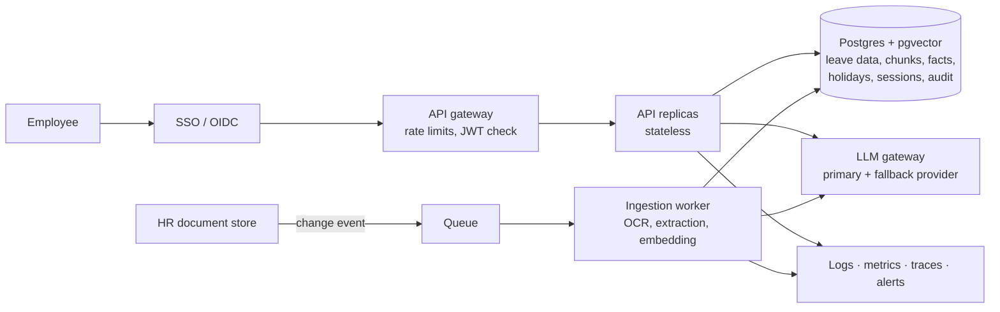

# Production Plan — Veltrix PeopleOps Assistant

> **Scope:** how the assessment build would evolve into a production service. None of this is built — it is deliberately out of scope for the assessment (TASK.pdf §1, §3). The core AI design (filtered hybrid RAG, precedence in code, permissions in tools, proposal-gated writes) carries over unchanged; this plan adds the operational layer around it.

---

## 1. What changes from the assessment build

| Area | Assessment build | Production |
|---|---|---|
| Identity | Trusted `X-Employee-Id` header | SSO (OIDC) → signed JWT; employee ID from verified token claims |
| Instances | One container | Stateless API replicas behind a load balancer |
| Database | SQLite file | Postgres (row-level locking, replicas, point-in-time recovery) |
| Vectors | FAISS in memory | pgvector (or Qdrant) with indexes on access level, region, effective date |
| Ingestion | At startup, blocks `/health` | Separate worker, incremental, triggered on document change |
| Sessions | SQLite table | Postgres table with retention policy |
| Logs | JSON to stdout | Central log store + metrics + tracing |
| LLM | One provider, retries | Primary + fallback provider, per-call budgets |
| Releases | `docker compose up` | CI/CD with eval gate, staging, gradual rollout |

## 2. Target architecture

## 3. Service goals (initial targets, to be refined with real traffic)

| Goal | Target |
|---|---|
| Availability | 99.5% monthly |
| Latency | p95 < 10 s, p99 < 20 s (hard limit 30 s) |
| Error rate | < 1% 5xx |
| Access-control violations | **Zero** — any occurrence is a P1 incident |
| Ingestion freshness | Changed document searchable within 15 min |

## 4. Security and threat model

| Threat | Mitigation |
|---|---|
| Impersonation (spoofed employee ID) | SSO + signed JWT; header-based identity removed |
| Reading restricted documents | Pre-retrieval filtering (unchanged) + `LLMClient` access re-assertion + periodic access audit tests in CI |
| Reading others' leave data | Permissions inside tools (unchanged) + audit log of every data access |
| Prompt injection via documents | Structural defences (unchanged) + red-team test set run on every release |
| Prompt injection via user | Planner manipulation intent → refuse; monitored refusal rates |
| Enumerating employees | Uniform refusal (unchanged) + rate limiting per user |
| Abuse / cost attacks | Gateway rate limits, per-user daily LLM budget |
| Secret leakage | Keys in a secrets manager, rotated; never in images or env files |
| Data breach | Encryption in transit (TLS) and at rest; least-privilege DB roles |

## 5. Data governance and privacy

- **Retention:** chat sessions deleted after a fixed period (e.g. 30 days); audit log kept per HR policy.
- **GDPR (DE employees) and local law (IN, US):** access and deletion requests supported for session data; data processing agreement with the LLM provider; zero-data-retention option where available.
- **Data minimisation (unchanged):** phones never read, emails masked, names only for visible employees, PII-free logs.
- **Audit trail:** separate append-only table — who viewed or changed which employee's leave, when, and via which request. Logs are for debugging; the audit trail is for accountability.
- **Region residency:** check whether the LLM provider region meets data-residency needs per country.

## 6. Observability

- **Metrics:** request rate, latency by route, error rate, LLM latency and tokens per call, corpus tokens per call (alert if any > 3,000), tool error rates, refusal and `no_answer` rates, ingestion lag.
- **Tracing:** one trace per request across planner → tools → retrieval → composer.
- **Alerts:** access-control assertion fired, budget guard fired, 5xx spike, LLM provider errors, ingestion failures or low-confidence OCR pages.
- **Quality monitoring:** daily eval run against production config; track route accuracy and citation precision over time; sample anonymised conversations for review with HR consent.

## 7. Model governance

- **Eval as release gate:** `make eval` (3 runs) must pass thresholds in CI before any prompt, model or retrieval change ships.
- **Model upgrades:** pinned model IDs; a new model version runs in shadow on the eval set before switching.
- **Provider fallback:** on primary provider outage, switch to the secondary adapter; both covered by the same contract tests.
- **Prompt versioning:** prompts stored as versioned files; version logged per LLM call.

## 8. Ingestion in production

- **Trigger:** document added/changed in the HR document store → queue → worker.
- **Incremental:** content-hash cache — only changed documents are re-parsed, re-extracted and re-embedded.
- **Quality gates:** ingestion report per document (OCR confidence, facts verified/dropped, clusters); a document with low-confidence OCR or many dropped facts is held for HR review before going live.
- **Versioning:** previous index version kept for rollback.
- **Scale (10,000 docs):** document-lineage graph for precedence, ANN clustering for rule keys, MinHash LSH for near-duplicates (see DESIGN.md §7).

## 9. Reliability and recovery

- **Timeouts and retries:** per-call timeouts within the 30 s budget; one retry; safe fallback answer.
- **Degraded mode:** if the LLM is down, tools-only answers for balances and requests; policy questions return "temporarily unavailable" rather than guesses.
- **Backups:** Postgres point-in-time recovery; tested restore quarterly.
- **Idempotency:** write actions carry the proposal ID — a retried confirmation never executes twice (extends the double-"yes" guard).

## 10. Rollout

1. **Staging** with production-like data (anonymised).
2. **Pilot:** one region, HR team first, then managers, then all employees.
3. **Feature flags:** write actions (apply/cancel) enabled after read-only answers prove reliable.
4. **Gradual rollout** with automatic rollback on alert thresholds.

## 11. Cost

- **Per request:** ~2 LLM calls; prompt caching for the static system prompt and tool schemas.
- **Controls:** per-user and global daily budgets; alerts at 80%.
- **Ingestion:** extraction cost only on changed documents (incremental cache).
- **Track:** cost per conversation and per route in metrics.

## 12. Incident response and human escalation

- **Severity:** P1 = any access-control or PII leak; P2 = wrong policy answers at scale or writes failing; P3 = degraded latency.
- **Runbooks:** provider outage, budget guard firing, bad ingestion (roll back index version), suspected data leak (disable feature flag, preserve audit trail, notify DPO).
- **Wrong policy answer reported:** trace via request ID → check retrieval, facts and precedence → fix extraction or document → add as eval case.
- **Escalation to HR:** `no_answer`, unresolved conflicts and repeated clarifications offer a "contact HR" handoff with the conversation summary (PII-minimised).

## 13. Phased roadmap

| Phase | Scope |
|---|---|
| **0 — Assessment build** | Current design: single container, all functional requirements, tests, eval |
| **1 — Secure foundation** | SSO/JWT, Postgres + pgvector, secrets manager, audit trail, CI with eval gate |
| **2 — Operate** | Metrics, tracing, alerts, ingestion worker, staging, pilot rollout |
| **3 — Scale** | Multiple replicas, lineage graph, ANN clustering, provider fallback, cost controls |
| **4 — Extend** | Approval workflow, notifications, HR escalation, half-day leave (all out of assessment scope) |
